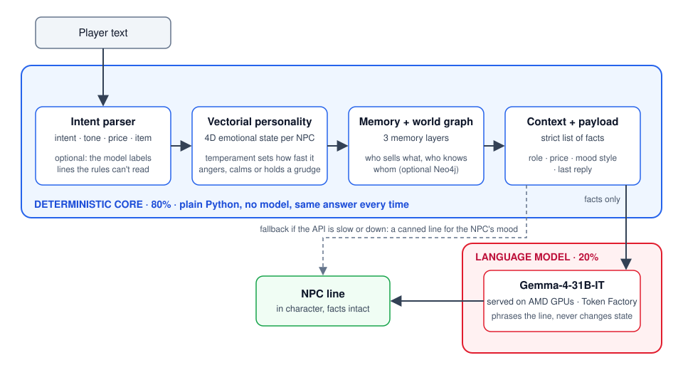

# Affekt Core

A narrative engine that gives game NPCs emotion, memory and context, so they answer players in
character without losing track of the world.

Affekt follows an **80/20 split**: 80% deterministic logic, 20% language model. Plain code
decides what the NPC feels, remembers and knows; the model only phrases the final line. The model
never changes game state, so NPCs can't invent prices, items or relationships.

Built for the **AMD Developer Hackathon: ACT III**. The language model is swappable: the default is
Gemma-4-31B-IT on AMD GPUs through AMD Token Factory, with MiMo-V2.6-Flash (also on AMD) as the backup
(see [docs/amd.md](docs/amd.md)); the measurements in `docs/` were taken with Gemma-4-31B-IT.

## Features

- **4D emotional state per NPC** (valence, initiative, stress, inertia) that decides the NPC's mood.
- **Three-layer memory** (short, medium, long term) with importance-based consolidation and forgetting.
- **World graph** of NPCs, places, items and events, in memory or persisted to Neo4j.
- **Free-text understanding**: a rule-based parser reads the player's intent, tone, offered price and item;
  an optional model resolves ambiguous lines.
- **Time of day**: the host passes the player's local hour (`engine.set_time_of_day(hour)`), the payload gets a `Time: morning.` line, and NPCs greet with "Good morning", "Good afternoon" or "Good evening" (late at night they mention it is late). Only greetings are constrained; the rest of the line is still the model's.
- **Provider failover**: `FailoverBackend` asks Gemma 4 on AMD Token Factory first, then MiMo on AMD, when the one before fails or is slow; a failing step is skipped for 45 s. If every provider fails the NPC answers with its canned line.
- **Graceful fallback**: if the model is unreachable, NPCs answer with deterministic lines for their mood.
- **Fact guard**: a price in the model's reply that differs from the engine's is replaced before the player sees it.
- **Standard library only** for the engine, the tests and the AMD API client.

## Architecture



How the AMD-hosted model is used, and what was and was not measured: [docs/amd.md](docs/amd.md).

Measurements (latency, error rate, fact checks, parser accuracy with confidence intervals), their limits and
what is still missing: [docs/evaluation.md](docs/evaluation.md).

## Try it

Requires Python 3.9 or newer. No packages to install.

**1. Run the tests**

```powershell
python -m unittest discover -s test
```

**2. Chat with the NPCs**

Offline, with no model (NPCs answer with canned lines):

```powershell
python demo.py --offline
```

With Gemma-4-31B-IT on AMD hardware: create a `.env` file in the project root with your AMD Token
Factory key (the file is git-ignored), then run the demo without flags.

```
AMD_API_KEY=rc-...
```

```powershell
python demo.py
```

```
you> Hey Marta, how much for a healing potion?
Marta [neutral, buy]> ...
you> /npc kael
you> I draw my sword and attack you!
Kael [hostile, attack]> ...
```

Commands: `/npc <name>` switches NPC, `/who` lists them, `/quit` exits.

## Use it in your code

```python
from AffektEngine import create_engine

engine = create_engine()   # uses the AMD API when AMD_API_KEY is set
r = engine.process_action("NPC_1", "Hey Marta, how much for a healing potion?")
print(r["response"], r["intent"], r["mood"])
```

`process_action` returns a dict with:

| Key | Meaning |
|---|---|
| `response` | The NPC's line |
| `mood` | `friendly`, `neutral`, `tense` or `hostile` |
| `intent`, `offer`, `addressed` | What the parser understood, a price offered, and the NPC name the player used |
| `llm_used` | Whether the model phrased the line or a deterministic line was used |
| `payload` | The exact facts the model was given |
| `price_guard` | What the price guard did: `ok` (checked, left as is), `corrected`, `blocked`, or `not_checked` (no model was used) |
| `memory_event`, `graph_nodes`, `graph_edges` | Memory stored and graph neighbourhood used |

### Options

```python
create_engine(use_amd_api=True)             # force the AMD API
create_engine(model_path="model/x.gguf")    # use a local GGUF model (needs llama-cpp-python)
create_engine(llm=StubBackend())            # no model at all, for tests
create_engine(llm_intents=True)             # let the model label lines the rules don't understand
engine.add_alias("NPC_1", "Big M")          # a nickname the player may use for an NPC
```

With no `model_path`, the AMD API is used when `AMD_API_KEY` is available (environment or `.env`).
API calls give up after 30 s and 2 retries, and the engine falls back to a canned line for the NPC's mood.

`llm_intents` is off by default. It adds one API call for each line the rules can't classify and
raised intent accuracy on 50 held-out lines from 54% to 64%.

### AMD Token Factory notes

- Endpoint: `https://developer.amd.com.cn/radeon/api/v1` (OpenAI-compatible), default model `Gemma-4-31B-IT` (it was off the catalog on 2026-10-15 and is back, but loaded; `MiMo-V2.6-Flash` is the tested alternative; pick another with `AMDBackend(model=...)`).
- A team shares one key and its limits: about 20 requests per minute and 8 concurrent. Replies can
  take from a few seconds to under a minute depending on load.
- The service is for trial and development, with no SLA. Don't commit the key.

## Cost per experience

The design goal is **local first**: a small fine-tuned model running on the player's own machine, so the
studio pays nothing per player and nothing per line. The hosted API is the option for players without the
hardware, and what we used to prove the engine works. Status: the local backend exists (`create_engine(model_path=...)`,
llama.cpp, GGUF) but **no fine-tuned model has been trained yet** and local speed has not been measured
([docs/finetune_compact.md](docs/finetune_compact.md) is the plan). The numbers below are for the hosted API only.

Estimate, not a measurement. A typical NPC prompt is 170-255 input tokens (708-1023 characters from the demo
conversations, at about 4 characters per token); the reply is capped at 160 tokens and is usually 1-2 sentences.
At an assumed reference price for a hosted Gemma 4 31B ($0.20 per million input tokens, $0.40 per million
output tokens, a public list price checked 2026-10-15; AMD Token Factory's free tier does not bill per token):

| | Calculation | Cost |
|---|---|---|
| One NPC line (typical, about 40 output tokens) | 210 x $0.2/M + 40 x $0.4/M | about $0.00006 |
| One NPC line (worst case, 160 output tokens) | 255 x $0.2/M + 160 x $0.4/M | about $0.0001 |
| One 30-line play session | 30 x the worst case | under $0.003 |
| 1,000 sessions | | about $2-3 |

The engine also skips the model for short filler lines (it answers with a canned line for the mood), so real
cost is somewhat lower. Prices change; re-check before relying on them. The AMD Token Factory free tier has no
per-token price but is rate limited (about 20 requests per minute for the whole team).

**Who pays.** Independent game studios that want NPCs with memory without writing branching dialogue. With a local
model the studio's inference bill is zero; revenue is planned from paid tools, support and a marketplace on top
of the MIT-licensed core (see `Kankei_Engine/hackathon/Business method.md`).

## Tests and benchmarks

| Command | What it does |
|---|---|
| `python -m unittest discover -s test` | Unit tests (no network, no model) |
| `python test\check_guard.py rows.jsonl` | Runs the price guard over saved replies |
| `python test\basic_tests.py` | Wiring checks plus a 20-action simulation with metrics |
| `python test\eval_intent.py --set all` | Intent accuracy of the rules on 179 test lines |
| `python test\eval_labeled.py [--llm] [--reserve]` | Accuracy on 200 hand-labelled lines (150 for tuning, 50 held out) |
| `python test\eval_llm.py --amd` | Reply quality for the API model (tone, facts, length, variety) |
| `python test\review_lines.py lines.txt --out review.csv` | Label your own lines and score the parser (`--score` to compute) |

## Optional: Neo4j persistence

```powershell
pip install neo4j
docker run -d --name neo4j -p 7687:7687 -p 7474:7474 -e NEO4J_AUTH=neo4j/password neo4j:5
```

```python
engine = AffektEngine(neo4j_uri="bolt://localhost:7687", neo4j_user="neo4j",
                      neo4j_password="password", connect_neo4j=True)
```

`engine.save_snapshot("world.cypher")` exports the graph as Cypher statements.

## Project structure

```
AffektEngine.py        engine and create_engine()
demo.py                terminal chat with the NPCs
modules/
  VectorialPersonality.py   4D emotional state and mood
  MemorySet.py              three-layer memory
  ContextFunction.py        scene context, triggers and the payload for the model
  GraphDatabase.py          world graph (in memory, optional Neo4j)
  IntentParser.py           rule-based reading of player text
  IntentLLM.py              optional model fallback for ambiguous lines
  LLMLayer.py               prompts and model backends
  ApiBackend.py             hosted-model clients: AMD Token Factory (AMDBackend)
test/                  unit tests, benchmarks and labelled data
training/              dataset tools for a future fine-tune of a small local model
```

## Troubleshooting

| Symptom | Fix |
|---|---|
| `AMD_API_KEY not found` | Add it to `.env` in the project root, or set it in the environment |
| `HTTP 429` or slow replies | The team key is rate-limited; the client retries using the server's `Retry-After` |
| `HTTP 401` / `403` | Wrong or rotated key, or the account is still under review |
| `No Gemma 4 model found` | You asked for a local model: pass `model_path=` or set `AFFEKT_MODEL` |
| `ModuleNotFoundError: modules` | Run commands from the project root |

## License

MIT. See [LICENSE](LICENSE).
